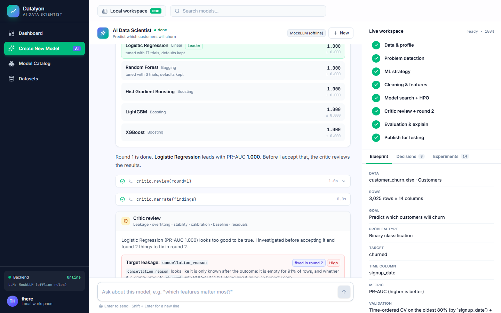
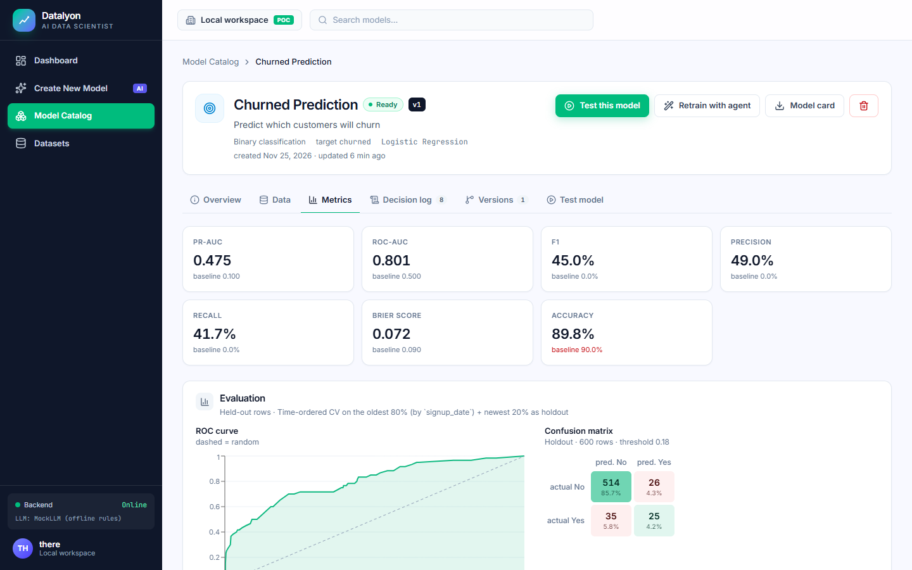
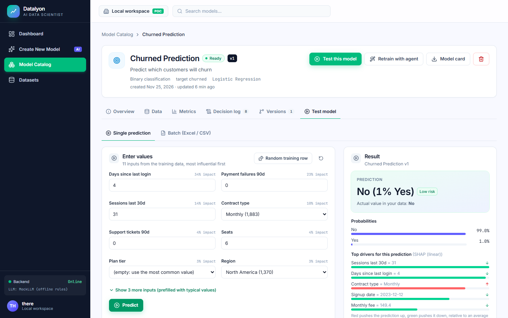
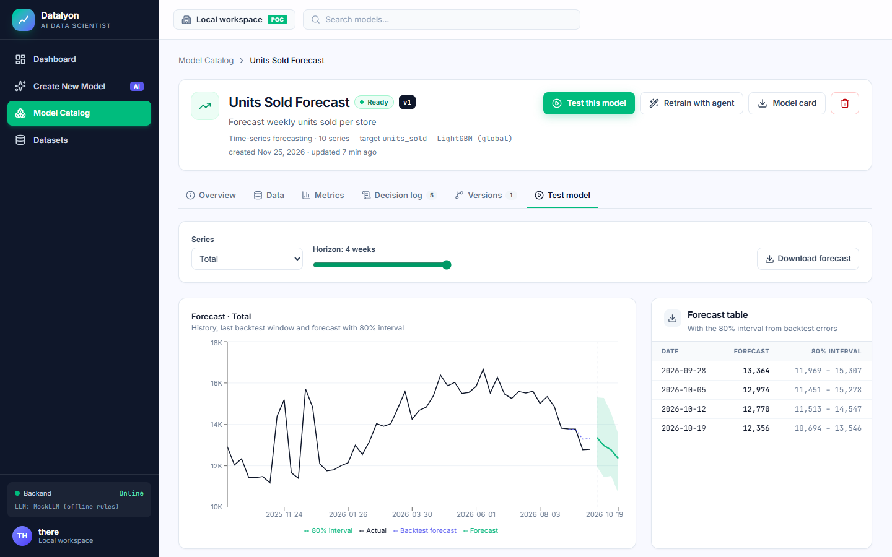

# Datalyon: AI Data Scientist

Upload an Excel or CSV file, describe what you want to predict, and chat with an agent. The agent frames the problem, cleans the data, trains and critiques real models, and publishes one. You can then test it in the app with a single-row form, batch Excel scoring or a forecast view.

It handles binary classification, multiclass, regression and time-series forecasting (single or many series). It runs fully offline with a rule-based LLM, or with Google Gemini when you add a key.



## Quick start

You need Python 3.12 with [uv](https://docs.astral.sh/uv/) and Node 22.

```bash
make setup      # uv sync + npm ci + copy .env.example to .env
make dev        # API on :8000, web app on http://localhost:5173
```

On Windows without GNU make, run the same targets with PowerShell: `./make.ps1 setup`, then `./make.ps1 dev`.

Open http://localhost:5173, then click a sample under **Create New Model** or drop your own spreadsheet. Five messy sample workbooks ship in `data/samples/`; `make samples` regenerates them.

**Using Gemini.** Set `LLM_PROVIDER=gemini` and `GEMINI_API_KEY=…` in `.env`. Gemini writes the explanations and interprets free-text answers. Metrics and decisions always come from code, and any failed LLM call falls back to the offline rules.

**Using Docker.** `docker compose up --build` serves the same two services.

## What happens in a run

| Stage | What the agent does | Asks you ✋ |
|---|---|---|
| Data & profile | Finds the header row under title rows, cleans `$1,200`, `#N/A` and mixed dates, profiles every column | Which sheet |
| Problem detection | Picks the target from your goal and decides the problem type | Confirm the target; forecast horizon |
| ML strategy | Chooses validation (stratified, time-ordered or rolling-origin) and the metric | none |
| Cleaning & features | Builds a leakage-safe cleaning and feature plan | Approve the plan |
| Model search + HPO | Cross-validates baseline, linear, forests and boosting; tunes the best with Optuna | none |
| Critic + round 2 | Checks for leakage, a weak baseline lift, overfitting, imbalance, calibration and residuals, then retrains with fixes | none |
| Evaluation | Scores the top 3 on a holdout; reports curves, a confusion matrix and SHAP drivers | Accept the final model |
| Publish | Saves a versioned pipeline, model card and input schema | none |

If no model beats the baseline by more than the noise, the agent says so and stops instead of publishing a useless model.



## Testing a model

Every published model has a **Test model** tab:

- **Single prediction:** a form generated from the training data, with typed inputs, category options and range warnings. Each prediction shows its top drivers.
- **Batch:** upload an Excel or CSV file and download it back with prediction columns added.
- **Forecast:** pick a series and horizon to see history, backtest, forecast and an 80% interval, and download the table.




## Repository

```
apps/web          React 19 · Vite · TypeScript · Tailwind v4 · TanStack Query · Recharts · Zod
services/api      FastAPI · Pydantic v2 · SQLAlchemy 2 + SQLite + Alembic
  src/datalyon/ml      pure ML library (pandas, scikit-learn, LightGBM, XGBoost, Optuna, SHAP)
  src/datalyon/agent   staged agent, LLM adapters (Gemini / Mock), SSE event bus
data/samples      messy demo workbooks
docs              architecture, ML pipeline, agent event protocol, ADRs
```

- [docs/architecture.md](docs/architecture.md): components and data flow
- [docs/ml-pipeline.md](docs/ml-pipeline.md): every stage, rule and threshold
- [docs/agent-events.md](docs/agent-events.md): the SSE event protocol
- [docs/adr/](docs/adr/): decision records

The CLI runs the ML engine without the app: `cd services/api && uv run python -m datalyon.cli ../../data/samples/house_prices.xlsx "predict the sale price"`.

## Development

```bash
make test       # pytest (ml + agent coverage gate 80%) and vitest
make lint       # ruff + oxlint + prettier
make typecheck  # mypy (strict for ml/ and agent/) + tsc
make gen-types  # export OpenAPI and regenerate apps/web/src/types/api.gen.ts
make e2e        # Playwright: upload churn, run the agent, single prediction, batch download
```

The integration tests drive full agent runs on every sample through the HTTP API with the offline LLM. They are marked `slow`; skip them with `-m "not slow"`.

## Configuration

All settings are environment variables; see [.env.example](.env.example). The main ones:

- `LLM_PROVIDER`: `mock` (default) or `gemini`.
- `TRAIN_TIME_BUDGET_S`: the model-search budget per run (default 300).
- `MAX_UPLOAD_MB`, `MAX_ROWS`, `MAX_COLUMNS`: upload limits.
- `STORAGE_DIR`: SQLite database, uploads and model artifacts.
- `MLFLOW_ENABLED`: logs every run to `storage/mlruns`.

## Limitations

- Excel and CSV upload only. There are no database connectors, scheduled retraining, external REST serving or deployment.
- It is a single-user local app, with no authentication and no multi-tenant isolation.
- Training runs in threads inside the API process (see ADR 0006). Long budgets and many parallel runs share one machine.
- Forecasting supports regular frequencies and global tree models; there is no exogenous future regressor input in the Playground.
